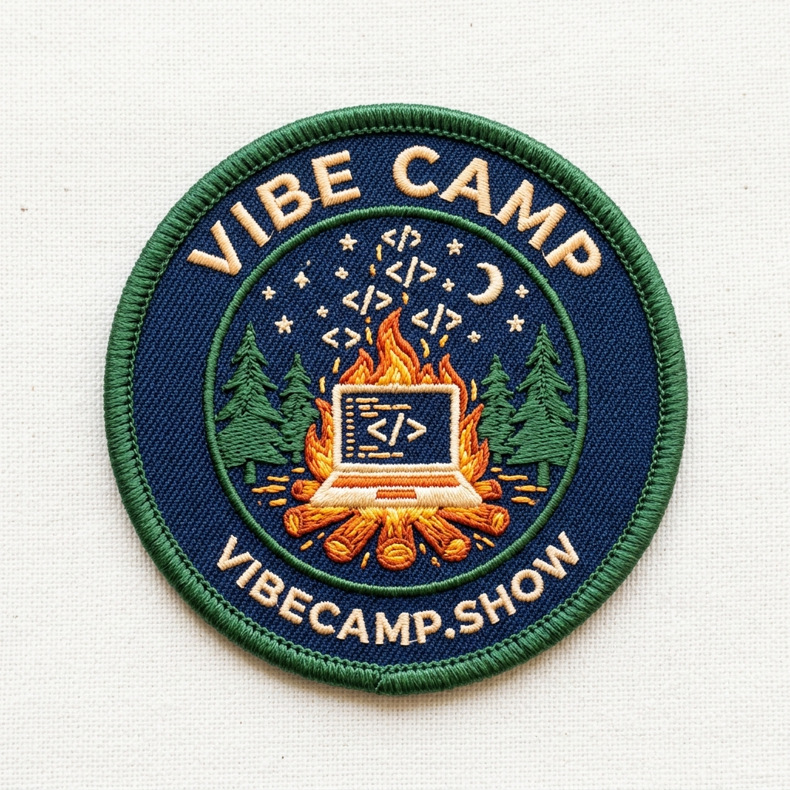

# Vibe Camp



**What's the Twitch stream of vibe coding?** Vibe Camp is Gabe, Stan and Jimmy (an AI participant running in [Vibe Conferencing](https://vibeconferencing.com)) building things live and in the open.

Episode 1 was meta: we built the show while recording it. That meant the YouTube channel, this repo, the theme song and the badge.

## Where

- YouTube: [@vibecamp-show](https://www.youtube.com/@vibecamp-show). Live streaming was requested 2026-10-19 09:31 MT and unlocks after 24 h.
- Domain idea: `vibecamp.show`, not registered yet.

## Theme song

[`music/vibe-camp-theme.m4a`](music/vibe-camp-theme.m4a) is the official take. Two shortened edits by Stan: [`music/vibe-camp-theme-short.wav`](music/vibe-camp-theme-short.wav) (19 s) and [`music/vibe-camp-theme-supershort.wav`](music/vibe-camp-theme-supershort.wav) (5 s sting). It was made with Suno; the cover art is in [`art/theme-cover.jpg`](art/theme-cover.jpg). The runner-up take is [on Suno](https://suno.com/song/feda24b6-9504-4821-bc8b-53ae57fada13).

**Style prompt:** campfire sing-along, upbeat acoustic guitar strumming, hand claps, group gang vocals, ukulele, whistling, cheerful summer camp jingle, short TV show theme

```
[Intro]
(hand claps)

[Verse]
Grab your laptop, pull up a log,
We're shipping code in the morning fog,
No plan, no map, just a vibe and a spark,
We'll build it live before it gets dark!

[Chorus]
It's Vibe Camp! (Vibe Camp!)
Gather round the glow,
Vibe Camp! (Vibe Camp!)
Coding on the show!
Stan and Gabe and Jimmy too,
Vibe Camp's coming live to you!

[Outro]
(everyone) Viiiibe Caaaamp!
```

Suno sang "live" to rhyme with "give", not "five". We kept it.

## Episodes

- [Episode 1: Building the show](episodes/001-building-the-show.md) (2026-10-19)

## Badge

[`art/badge.png`](art/badge.png) is the chosen badge. [`art/badge-alt.png`](art/badge-alt.png) is the runner-up. Both were made with Nano Banana.
